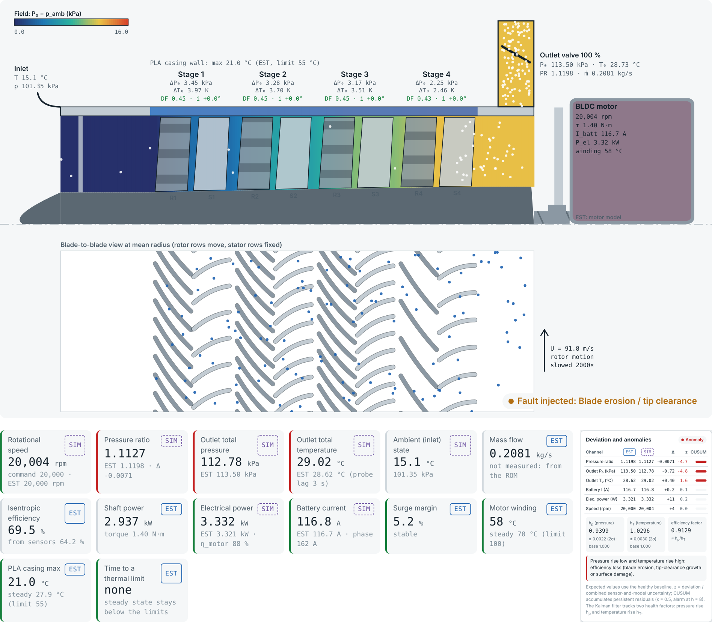

# Digital Twin of a 3D-Printed Four-Stage Axial-Flow Compressor

**Team 12 · AE 541 Digital Twin in Modern Engineering · King Fahd University of Petroleum & Minerals**
Mohammad Inshal Naved (202530770) · Muhammad Salman Khalid (202530850)

A digital twin of a four-stage, PLA-printed axial compressor (design pressure ratio **1.12 at 20,000 rpm, 0.208 kg/s**) driven by a
brushless motor. The twin holds a requested pressure ratio by commanding the motor speed. It also estimates quantities that are not
measured (mass flow, efficiency, surge margin, casing and motor temperatures) and detects degradation with a Kalman filter on two
health factors.

> **Data status (19 Nov 2026):** the rig is under construction. **Every dataset, figure and result in this repository is simulated**
> by the physics model or the virtual rig, and is labelled that way. `data/raw/` stays empty until the first measured run.



---

## What is in the twin

```
 physical rig                      sense & act                     twin core                              user
 ─────────────                     ───────────                     ─────────                              ────
 4-stage PLA compressor   ──►  PT100 ×2 (MAX31865)      ──►  full-order mean-line model (offline)   ──►  web dashboard
 BLDC motor + VESC              LPS33HW ×2 (+ bellmouth)       POD reduced-order model (4 modes, 4 µs)    deviation / anomaly panel
 outlet valve                   VESC telemetry (rpm, I, V)     thermal OpInf ROM + motor model            experiment log, exports
                                Arduino UNO R4 WiFi            Kalman filter (h_p, h_T) + CUSUM
                                MQTT (JSON, seq, UTC, quality) PR controller: inverse-ROM FF + PI  ──► speed command ──► VESC
```

| Layer | Where | Status |
|---|---|---|
| Aerodynamic design and CAD | `docs/reports/`, `cad/` | done |
| Full-order model (mean-line stage stacking) | `src/modelling/offdesign.py` | done; reproduces the design point exactly |
| Dataset (60 operating points, 45 train / 15 test) | `src/modelling/gen_dataset.py` → `data/processed/` | done (simulated) |
| POD reduced-order model (speed × valve opening) | `src/modelling/build_pod_rom.py` → `models/pod_rom/` | done |
| 1-D polynomial surrogate (speed only, v1) | `src/modelling/build_rom.py` → `models/rom_v1/` | done |
| Web twin (simulation, virtual rig, KF, CUSUM, control, logging) | `src/dashboard/` → `docs/index.html` | done |
| Python twin with Flask dashboard and serial link | `src/twin/` | done |
| Firmware and serial → MQTT bridge | `src/acquisition/` | written; hardware test pending |
| Validation on measured data | — | planned (see the interim paper, Sec. VIII) |

## Key results (simulated)

| Quantity | Value |
|---|---|
| ROM pressure-ratio error on 15 held-out points | max 4.3×10⁻⁴, R² = 0.99998 |
| ROM outlet-temperature error | max 0.028 K |
| POD modes kept | 4 (99.99993 % of the variance) |
| ROM evaluation time | 4.4 µs (JavaScript); full-order model 0.28 s |
| Thermal ROM (2 modes, operator inference) | max error 0.015 K on a held-out history |
| Fault test (blade erosion) | detected 0.2 s after injection; h_p 0.9286 (true 0.928) |
| Model-form uncertainty at 20,000 rpm (95 %) | PR 1.1143 – 1.1257 |

Full write-up: [`docs/reports/Team12_Interim_Paper.pdf`](docs/reports/Team12_Interim_Paper.pdf).

## Quick start

```bash
git clone <this-repo> && cd compressor4-digital-twin
python -m venv .venv && source .venv/bin/activate        # Windows: .venv\Scripts\activate
pip install -r requirements.txt

# 1) one operating point: change the rpm and get everything else
python src/modelling/compressor_rpm_calculator.py 15000

# 2) open the web twin (no server needed)
open docs/index.html                                     # or double-click it; Windows: start docs\index.html

# 3) Python twin with the Flask dashboard (simulated rig; add --port COM5 for the real board)
python src/twin/app.py                                   # then browse to http://127.0.0.1:5000

# 4) run the tests
pytest -q
```

## Rebuild everything from scratch

```bash
bash run_all.sh            # or: make all
```

The script runs these steps in order:

| Step | Command | Output |
|---|---|---|
| 1 | `python src/modelling/gen_dataset.py` | `data/processed/*` (dataset, map, surge line) |
| 2 | `python src/modelling/make_map_json.py` | `models/pod_rom/map.json` |
| 3 | `python src/modelling/build_rom.py` | `models/rom_v1/`, `figures/rom_v1/` |
| 4 | `python src/modelling/build_pod_rom.py` | `models/pod_rom/` (ROM, DOE, metrics) |
| 5 | `python src/dashboard/build_site.py` | `docs/index.html` (+ `src/dashboard/dist/artifact.html`) |
| 6 | `python src/twin/run_closed_loop_test.py` | `figures/twin/`, `data/processed/twin_closed_loop_test.csv` |
| 7 | `python src/analysis/uq_mc.py` · `gum.py` | `data/processed/analysis/*.json` |
| 8 | `python src/analysis/twin_scenarios.py` *(needs Playwright + Chromium)* | `data/processed/analysis/twin_scenarios.json` |
| 9 | `python src/analysis/make_figs.py` · `fig_arch.py` · `shot_dash.py` | `figures/paper/` |
| 10 | `pytest -q` | 7 checks |

The whole chain takes about 2 minutes on a laptop.

## Repository layout

```
compressor4-digital-twin/
├── README.md               this file
├── requirements.txt        Python dependencies
├── run_all.sh  Makefile    rebuild pipeline
├── data/
│   ├── raw/                measured rig logs, kept unchanged (empty until the rig runs)
│   ├── processed/          simulated dataset, compressor map, twin test logs, analysis results
│   └── data_dictionary.md  every column, unit and source
├── models/
│   ├── pod_rom/            rom_pod.json (POD basis, amplitude maps, thermal ROM), DOE, metrics, map.json
│   └── rom_v1/             1-D surrogate (speed only) and its metrics
├── src/
│   ├── acquisition/        Arduino firmware, USB-serial link, serial→MQTT bridge, message schema
│   ├── modelling/          design geometry, full-order model, dataset, ROM builders, rpm calculator
│   ├── twin/               Python twin core (estimation + control) and Flask dashboard
│   ├── dashboard/          web twin source (HTML/CSS/JS) and its build script
│   └── analysis/           uncertainty, sensor budget, virtual-rig scenarios, paper figures
├── notebooks/              01_end_to_end_walkthrough.ipynb
├── figures/                paper figures, ROM validation, twin tests
├── tests/                  pytest checks of model, ROMs, twin and bridge
├── cad/                    STEP parts and assembly, SolidWorks macro, renders
└── docs/
    ├── index.html          the web twin (GitHub Pages entry point)
    └── reports/            interim paper, design report, hand calculations, twin report
```

## Web twin

`docs/index.html` is a single self-contained page: the four-stage compressor simulation driven by the ROM, the virtual rig with six
fault types, the Kalman-filter health factors and CUSUM deviation panel, CSV upload and replay, an experiment log, a lab checklist,
and report exports. Enable **GitHub Pages → Deploy from branch → `main` / `docs`** to host it.
Outside claude.ai the log and checklist are kept in the browser (localStorage); the hosted claude.ai version keeps them in a shared database.
Every value on the page is tagged **measured**, **simulated**, **estimated** or **design**.

## Hardware (planned bill of materials)

Hobbywing EZRUN 5687SL 1100 kV motor · Flipsky 75200 Pro V2 VESC · 8S LiPo (2 × 4S 10 Ah) · 7005C P4 angular-contact bearings (4) ·
Ø25 mm shaft · M4 A2 tie rods · high-speed coupling · 2 × PT100 + MAX31865 · 2 × LPS33HW · Arduino UNO R4 WiFi ·
polycarbonate guard, fuse and anti-spark switch.

## Limitations

- The loss, deviation and surge models are assumed (calibrated only at the design point). The model-form uncertainty (±0.006 in pressure ratio)
  is about 13 times the ROM error, so calibration on measured data is the next step.
- The motor, battery and thermal parameters are assumed values to be identified on the rig.
- The ROM is trained for 10,000–20,000 rpm (corrected) and valve opening 0.94–1.50. The twin flags anything outside this range as extrapolation.

## Use of AI tools

Generative AI (Claude, Anthropic) assisted with parts of the code, the figures and the editing of the documents, under the team's direction.
All results were run and checked by the team (see Appendix B of the interim paper).

## License

Code: MIT (see `LICENSE`). Reports, figures and CAD: © 2026 the authors, shared for teaching and research.
